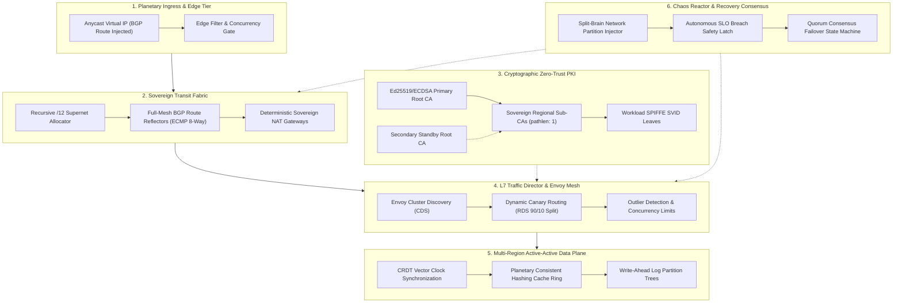

# Pontifex System Architecture

## 1. System Overview

Pontifex is an autonomous, planetary-scale cloud transit fabric, cryptographic identity hypervisor, and chaos resilience simulation platform implemented in declarative HashiCorp Configuration Language (HCL). Designed for mission-critical, multi-region sovereign cloud operations, Pontifex bridges disparate cloud provider networks into a unified, cryptographically verified transit substrate with sub-second failover, zero-trust mutual TLS (mTLS), and automated disaster recovery.

---

## 2. Core Architectural Subsystems

### 2.1 Planetary Sovereign Transit Fabric (`modules/transit_fabric`)
The transit fabric establishes non-overlapping, deterministic network topology across sovereign cloud jurisdictions (e.g., US FedRAMP, EU GDPR, APAC SG).
- **Recursive Supernet Allocation**: Partitions a root `/8` supernet (e.g., `10.0.0.0/8`) into sixteen `/12` regional blocks. Each `/12` is functionally sliced into five deterministic tiers: Public Ingress (`/16`), Private Compute (`/14`), Sovereign Data (`/15`), Transit Peering (`/20`), and Anycast PoP (`/24`).
- **Planetary BGP Route Reflector Mesh**: Elects primary and secondary regions as Route Reflectors with distinct Autonomous System Numbers (ASNs starting at `64512`). Establishes point-to-point `/30` interconnect links across all region pairs with 8-way Equal-Cost Multi-Path (ECMP) routing and Bidirectional Forwarding Detection (BFD).
- **Anycast Edge PoP Tier**: Virtual Router Redundancy Protocol (VRRP) routing groups inject global VIPs (`10.0.0.10`) with automated BGP community shedding (`64512:666`) during localized disruptions.

### 2.2 Cryptographic Zero-Trust PKI & SPIFFE Hypervisor (`modules/crypto_pki`)
Every node and microservice within Pontifex possesses a verifiable cryptographic identity anchored in an immutable X.509 hierarchy.
- **Dual-Root Trust Anchors**: Primary and Standby Root CAs generated using ECDSA P-384 curves with 10-year validity horizons.
- **Sovereign Intermediate CAs**: Regional issuing authorities constrained by basic constraints (`pathlen: 1`) to prevent rogue subordinate CA issuance.
- **SPIFFE SVID Workload Synthesizer**: Leaf certificates dynamically embed SPIFFE Verifiable Identity Document URIs:
  `spiffe://pontifex.internal/ns/{namespace}/sa/{service_account}`
- **Mutual TLS 1.3 Profile**: Restricts cipher suites to `TLS_AES_256_GCM_SHA384`, `TLS_CHACHA20_POLY1305_SHA256`, and `TLS_AES_128_GCM_SHA256`. Legacy TLS versions and insecure ciphers are strictly prohibited.

### 2.3 L7 Service Mesh & Dynamic Canary Director (`modules/service_mesh`)
- **Envoy Cluster Discovery Service (CDS)**: Compiles declarative upstream cluster definitions with HTTP/2 stream multiplexing, mTLS transport sockets, and active healthcheck intervals.
- **Weighted Canary Routing (RDS)**: Manages progressive traffic progression (e.g., 90% baseline, 10% canary) with header-based override triggers (`x-pontifex-canary: true`) and exponential backoff retry policies.
- **Outlier Detection & Circuit Breaking**: Ejects hosts that trigger consecutive 5xx errors (threshold: 3-5). Maximum ejection is capped at 50% to prevent cascading cluster failure.
- **Distributed Token-Bucket Rate Limiting**: Multi-tier descriptor trees govern per-service and per-caller invocation ceilings.

### 2.4 Zero-Trust Policy Matrix & Ephemeral Secret Governance (`modules/zero_trust`)
- **Layer 3/4 Microsegmentation**: Strict default-deny ingress and egress policies enforced per namespace. Only explicit port and protocol whitelists permit inter-workload communication.
- **JWT Claim Inspection**: Envoy HTTP filter chains validate OpenID Connect tokens, verify issuer signatures, check audiences, and extract role claims.
- **Rotating Ephemeral Credentials**: `time_rotating` triggers automatically refresh storage passwords, HMAC signing keys, and inter-sidecar authentication tokens every 24 hours.
- **Tamper-Evident Audit Ledger**: SHA-256 block hash chaining ensures that all configuration anchors and operational events form an immutable cryptographic history.

### 2.5 Active-Active Data Plane (`modules/data_plane`)
- **CRDT State Synchronization**: Implements Observed-Remove Sets (OR-Set) for identity sessions and Positive-Negative Counters (PN-Counter) for distributed balances, guaranteeing conflict-free eventual convergence.
- **Planetary Consistent Hashing Cache Ring**: Pure HCL virtual node synthesizer maps partition tokens across a 360-degree SHA-256 ring with replication factor `R = 3`.
- **Multi-Tier Storage Lifecycle**: Automated transition pipeline from Hot NVMe (0-30 days) to Warm Object Storage (30-90 days) to Cold Compliance Vaults (7 years) with Write-Once-Read-Many (WORM) legal hold locks.
- **Write-Ahead Log Partition Trees**: Distributed partitioned streams with configurable in-sync replica minimums and lag monitoring alerts.

### 2.6 Autonomous Chaos Reactor (`modules/chaos_reactor`)
- **Network Split-Brain Partition Drills**: Injects BGP peering disconnections to simulate fiber severances, verifying that the surviving majority partition retains consensus without split-brain anomalies.
- **Link Degradation & Packet Jitter**: Injects Gaussian latency delays (+120ms) and packet drop simulations (2-5%) to test TCP window backoff and Envoy retry loops.
- **Zone Evacuation Drills**: Drains compute and ingress tiers from designated availability zones within 60 seconds with zero customer impact.
- **Steady-State Hypothesis Verifiers**: Real-time SLO monitors evaluate error budget depletion. If error rates exceed 2.0% or P99 latency spikes past 500ms, emergency rollback tripwires instantly abort the drill.

### 2.7 Planetary Observability (`modules/observability`)
- **Golden Signals Prometheus Rules**: Automated alert group compilation covering P99 Latency, 5xx Error Rates, Traffic volume anomalies, and Connection Pool Saturation.
- **Alertmanager Routing Trees**: Multi-tier escalation trees with inhibition rules that suppress downstream noise when a root-cause regional outage is detected.
- **OpenTelemetry Tail-Sampling**: Retains 100% of error traces and anomalous spans while capturing a 5% baseline of healthy executions.
- **Synthetic Latency Probes**: Full-mesh cross-region synthetic HTTP and TCP probes continuous mapping planetary round-trip times.

### 2.8 Disaster Recovery & Quorum Consensus (`modules/disaster_recovery`)
- **Failover State Machine**: Formal six-state automaton governing cluster health transitions from `HEALTHY_NOMINAL` to `FAILOVER_PRIMARY_PROMOTED`.
- **Monotonic Fencing Tokens**: Prevents zombie leaders from committing stale writes during split-brain partitions.
- **Geo-Distributed Healthchecked DNS Records**: Low-TTL (60s) DNS failover records divert traffic between Anycast ingress points upon three consecutive health probe failures.
- **Declarative RPO/RTO SLA Verification**: Validates zero-data-loss durability (RPO = 0s) and sub-minute recovery (RTO <= 30s).

---

## 3. Mathematical & Algorithmic Invariants

### 3.1 Quorum Consensus Inequality
To guarantee strong consistency without stale reads across distributed regional replicas, Pontifex strictly enforces the classical quorum intersection inequality:
$$R + W > N$$
Where:
- $N$ is the total count of participating sovereign regions (default: 5).
- $R$ is the read quorum size: $\lfloor N/2 \rfloor + 1 = 3$.
- $W$ is the write quorum size: $\lfloor N/2 \rfloor + 1 = 3$.
- $3 + 3 = 6 > 5$, guaranteeing at least one node overlaps between any read and write set.

### 3.2 Consistent Hashing Ring Distribution
Virtual node tokens are distributed uniformly across the 256-bit SHA-256 address space:
$$T_{v,i} = \text{SHA256}(\text{region\_key} \parallel \text{"-vnode-"} \parallel i)$$
For $V = 64$ virtual nodes per region across $N = 5$ regions, the ring contains 320 uniformly balanced anchor points, minimizing key migration during node additions or removals to $K/N$ keys.

### 3.3 Tamper-Evident Block Hash Chaining
Audit ledger immutability is guaranteed by recursive cryptographic chaining:
$$H_0 = \text{SHA256}(0 \parallel \text{"000...000"} \parallel \text{Event}_0 \parallel \text{Digest}_0)$$
$$H_n = \text{SHA256}(n \parallel H_{n-1} \parallel \text{Event}_n \parallel \text{Digest}_n)$$
Any unauthorized modification of block $k$ invalidates all subsequent block hashes $H_m$ ($m > k$), making tampering immediately detectable.
